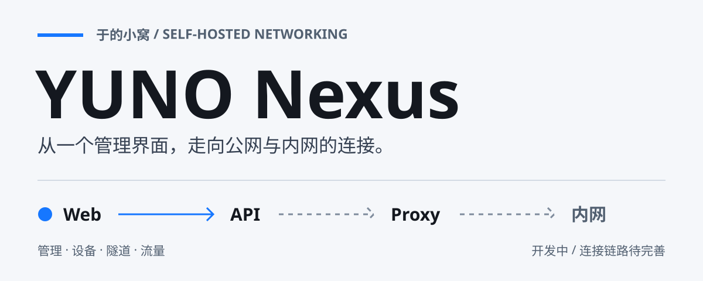
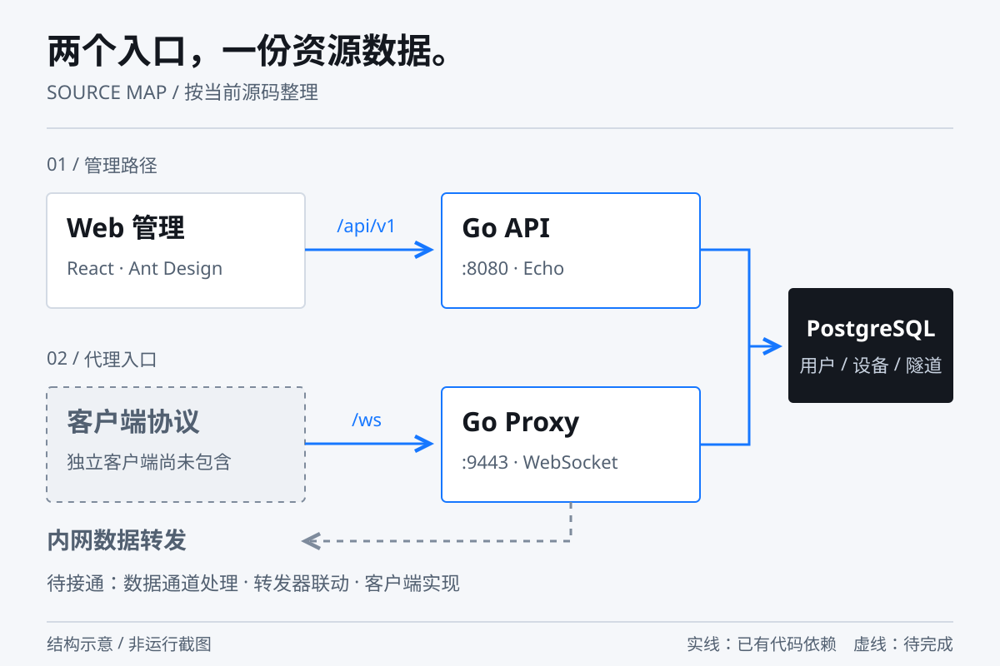

<p align="center">
  
</p>

<h1 align="center">YUNO Nexus</h1>

<p align="center">
  于的小窝 · 面向自托管的内网穿透项目<br>
  在一个 Web 界面中管理隧道、设备与流量，逐步接通公网与内网。
</p>

<p align="center">
  <a href="./version.json">0.2.7</a> ·
  <a href="#当前能力">当前能力</a> ·
  <a href="#本地开发">本地开发</a> ·
  <a href="#部署前检查">部署说明</a> ·
  <a href="#文档导航">项目文档</a>
</p>

> **开发中**：当前仓库包含管理界面、API 与代理基础代码。隧道数据转发仍有未接通环节，桌面和 Android 客户端尚未包含在仓库中。适合源码研究与继续开发，暂不作为开箱即用的穿透服务。

## 从管理到连接

YUNO Nexus 将管理接口与代理服务拆成两个 Go 入口：Web 界面通过 API 管理资源，代理服务负责 WebSocket 连接与消息处理，PostgreSQL 保存用户、设备和隧道等数据。

<p align="center">
  
</p>

图中实线表示源码中已有的入口与依赖，虚线表示仍需接通的数据链路；这是源码结构示意，不是运行截图。

- **管理界面**：仪表盘、隧道、设备、流量，以及管理员专用的用户与系统设置页面。
- **API 服务**：认证、资源管理、配置导入导出与管理员接口。
- **代理基础**：WebSocket 接入、二进制消息协议、心跳，以及转发、加密和压缩模块。

## 当前能力

以下按当前源码区分“已有代码”和“可完整使用”，避免将设计目标当作运行结果。

| 模块 | 仓库已有内容 | 当前边界 |
| --- | --- | --- |
| 账号认证 | 注册、登录、JWT、Argon2id、登录失败限流 | 登录流程含 TOTP 校验，尚无完整的绑定管理入口 |
| 隧道管理 | 创建、查询、编辑、删除、端口分配、启停接口 | 启停仅更新数据库状态，未驱动代理转发 |
| 设备管理 | 设备记录、列表、详情、改名、吊销接口 | 尚未形成独立客户端的设备接入闭环 |
| 流量统计 | 概览、按隧道及用户查询、Web 统计页 | 真实数据采集与完整转发链路仍需联调 |
| Web 管理 | React 页面、角色菜单、登录保护、403 页 | 部分页面操作与后端接口尚未对齐 |
| 代理引擎 | `/ws`、认证、心跳、TCP/UDP/HTTP 转发器代码 | 数据通道处理仍有 TODO，不能据此宣称五种协议均已可用 |
| 系统配置 | 配置导入导出、管理员配置与审计路由 | 管理员系统配置和审计处理器仍含占位实现 |

Windows / Linux 桌面客户端、Android 客户端、自动更新与系统通知属于后续方向，当前没有对应交付源码。

## 本地开发

### 环境

| 组件 | 要求 |
| --- | --- |
| Go | `go.mod` 声明 Go 1.24，使用满足该声明的工具链 |
| Node.js / npm | 选择兼容仓库 Vite 5 的 Node.js 版本 |
| PostgreSQL | 部署模板采用 PostgreSQL 16 |
| Docker Compose | 可选，用于数据库或部署配置检查 |
| Redis | Compose 模板包含 Redis 7；当前 Go 服务未见 Redis 接入代码 |

### 1. 获取源码

```bash
git clone https://github.com/Yu-xiaohei/YunoNexus.git
cd YunoNexus
```

### 2. 启动 Web 开发界面

```bash
cd web-admin
npm install
npm run dev
```

默认访问 `http://localhost:5173`。Vite 将 `/api` 代理到 `http://localhost:8080`；登录和业务操作需要后端及数据库，单独启动前端只能检查界面。

前端构建命令为 `npm run build`，产物位于 `web-admin/dist/`。

### 3. 准备数据库与环境变量

创建 PostgreSQL 数据库，并在**新建的开发数据库**中执行：

```text
server/internal/database/migrations/001_init.up.sql
```

该 SQL 是初始化脚本，不是可反复执行的增量迁移。它会创建表、扩展和初始数据；不要直接对已有业务数据库重复运行。

Go 服务从进程环境或**运行目录下的 `.env`** 读取配置。以下列出主要配置项，具体默认值见 [`config.go`](./server/internal/config/config.go)：

| 变量 | 默认值 / 配置要求 |
| --- | --- |
| `DB_HOST` / `DB_PORT` | `localhost` / `5432` |
| `DB_NAME` / `DB_USER` | `yunonexus` / `yunonexus` |
| `DB_PASSWORD` | 必须设置为实际数据库凭据 |
| `DB_SSLMODE` | 默认 `disable`；按数据库连接环境配置 |
| `JWT_SECRET` | 必须设置独立的随机密钥 |
| `SERVER_HOST` / `SERVER_PORT` | `0.0.0.0` / `8080` |
| `JWT_EXPIRY` / `REFRESH_EXPIRY` | `2h` / `168h` |
| `ALLOWED_PORT_START` / `ALLOWED_PORT_END` | `30000` / `30100`，用于 API 分配端口 |
| `TUNNEL_PORT_START` / `TUNNEL_PORT_END` | `30000` / `30100`，代理配置字段 |

**首次账号注意事项**：初始化 SQL 的管理员密码使用 bcrypt，而登录校验使用 Argon2id，两者当前不兼容。请先修正账号初始化流程；不要依赖脚本中的默认管理员登录。注册接口位于 `POST /api/v1/auth/register`，注册用户默认角色为 `user`。

### 4. 启动 Go 服务

从仓库根目录打开终端，确认数据库与环境变量已准备好：

```bash
cd server
go mod download
go run ./cmd/server
```

API 默认监听 `8080`，健康检查为 `GET http://localhost:8080/health`，业务接口前缀为 `/api/v1`。

需要研究代理协议时，在另一个终端的 `server/` 目录运行：

```bash
go run ./cmd/proxy
```

当前代理入口固定监听 `9443`，WebSocket 路径为 `/ws`。它直接提供 HTTP/WS，TLS 由前置反向代理终止；设置 `PROXY_PORT` 尚不会改变该入口的监听地址。代理进程启动不代表隧道数据链路已接通。

## 部署前检查

仓库提供 [`docker/docker-compose.yml`](./docker/docker-compose.yml) 与 Nginx 模板，描述了 Nginx、API、Proxy、PostgreSQL 和 Redis 的组合。**当前模板需要调整后使用**，这里不将它包装成一条命令即可上线的安装方式。

<details>
<summary><strong>展开部署准备与已知差异</strong></summary>

- **构建路径**：API Dockerfile 复制 `/app/migrations`，实际初始化 SQL 位于 `server/internal/database/migrations/`，需修正复制路径。
- **Go 版本**：两个 Dockerfile 仍采用 `golang:1.22-alpine`，与 `go.mod` 的 Go 1.24 声明不一致。
- **环境配置**：仓库没有 `.env.example`。Compose 需要 `DB_PASSWORD`、`JWT_SECRET`、`REDIS_PASSWORD`；代理服务还需获得与 API 一致的 `JWT_SECRET`。
- **前端产物**：Nginx 挂载 `web-admin/dist/`，部署前先完成前端构建。
- **域名与证书**：替换 Nginx 中的 `your-domain.com`，准备挂载目录中的 `cert.pem` 与 `key.pem`。自定义域名还需同步检查 API CORS 与 WebSocket 来源白名单。
- **监听与映射**：模板映射 `80`、`443`、`9443`、`30000–30100` 和数据库端口。隧道端口映射当前只有 TCP；研究 UDP 转发时需要单独核对 UDP 映射。
- **首次登录**：先解决初始化管理员的密码哈希格式差异，再验证管理端登录与权限。

从仓库根目录检查 Compose 结构时，显式指定配置路径：

```bash
docker compose -f docker/docker-compose.yml config --quiet
```

该命令只校验 Compose 配置，不代表镜像构建、证书加载、数据库初始化或内网穿透已验证。

</details>

### 安全边界

项目已有密码哈希、JWT、TOTP 校验、来源白名单及 AES-GCM 等相关代码，但不据此承诺完整的端到端安全：

- 当前 `/ws` 入口本身不启用 TLS；公网连接需要正确的 HTTPS/WSS 终止配置。
- 加密和压缩模块存在，不代表它们已经接入全部数据通道。
- Web 的“记住密码”会将密码保存到 `localStorage`，使用共享设备前应了解这一行为。
- PostgreSQL 的 SSL 默认关闭；不要将现有默认配置理解为数据库连接已加密。

## 源码导航

```text
YunoNexus/
├── server/
│   ├── cmd/server/              # 管理 API 入口
│   ├── cmd/proxy/               # WebSocket 代理入口
│   └── internal/
│       ├── api/                 # 路由处理、响应与认证中间件
│       ├── auth/                # JWT、密码、TOTP、登录限流
│       ├── config/              # 环境变量配置
│       ├── database/            # 数据查询与初始化 SQL
│       ├── models/              # 数据模型
│       └── proxy/               # 协议、心跳、转发、加密与压缩
├── web-admin/                   # React + TypeScript + Ant Design
├── docker/                      # Compose、Nginx 与部署挂载
├── docs/                        # 架构、开发与 Wiki 文档
├── wiki/                        # 仓库内的 Wiki 文档副本
├── assets/readme/               # 可编辑的 README 静态图
└── version.json                 # 项目版本与版本说明
```

## 文档导航

| 想了解什么 | 从这里开始 |
| --- | --- |
| 系统如何拆分 | [架构概览](./docs/architecture.md) · [完整设计](./docs/architecture-full.md) |
| 有哪些 API | [API 参考](./docs/wiki/API-Reference.md) |
| 如何排查错误 | [错误码说明](./docs/error-codes.md) |
| 版本改了什么 | [更新日志](./CHANGELOG.md) |
| 历史开发约定 | [开发指南](./docs/dev-guide/README.md) |
| Wiki 内容 | [仓库内 Wiki 首页](./docs/wiki/Home.md) |

部分设计文档和开发指南描述的是历史阶段或目标架构；判断当前实现时，以源码及本 README 的能力边界为准。

## 参与开发

欢迎通过 [Issues](https://github.com/Yu-xiaohei/YunoNexus/issues) 报告问题或提出改进，通过 Pull Request 贡献代码。问题报告请附上版本、运行环境、复现步骤与脱敏日志。

当前优先补齐代理数据通道、客户端接入、前后端接口一致性及部署流程。提交前分别检查后端与前端：

```bash
# server/ 目录
go test ./...
go build ./cmd/server ./cmd/proxy

# web-admin/ 目录
npm run build
```

这些是贡献前的检查命令，不表示当前分支已经通过全部检查。

## 作者与许可

由 **[Yu_xiaohei](https://github.com/Yu-xiaohei)** 创建和维护。

项目在 `version.json` 中声明 **MIT**；当前仓库尚未包含独立的 `LICENSE` 文件，分发前应补齐正式许可文本。
